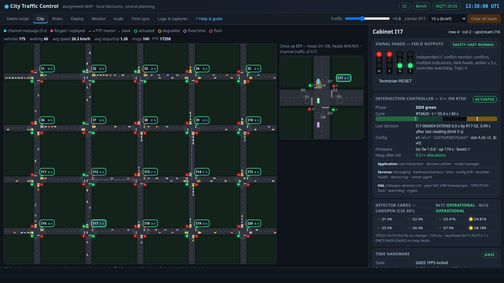

# Qblox Software Architect Assignment — Traffic Signal Control MVP

A working minimum viable product of the design in *Aashutosh Joshi — Qblox Architect Assignment*
(“decide locally on current, synchronized, time-stamped data; plan, validate, diagnose and observe
centrally; rules are data, not code”). Every box of the proposed architecture runs as a real process
on one Linux host and talks a real protocol. Only the street, the cabinet hardware and the two
networks are emulated, by a hardware-in-the-loop (HIL) testbench.

> **New here?** Read the plain-language guide **[docs/GUIDE.md](docs/GUIDE.md)**. It is also built into the
> GUI as the **? Help & guide** tab, with a live list of all running processes. It explains the city,
> the signal cycle, every rule field, how a rule becomes a signed binary and reaches the controllers,
> where every file is, and what each injected fault does, with screenshots.
>
> **Videos** (attached to the [v1.0 release](https://github.com/joshiashutosh201215-hue/qblox-traffic-signal-controller-demo/releases/tag/v1.0)): a 5-minute live demo and an
> 11-minute code walkthrough.



## Requirements and quick start

Linux only: tested on Ubuntu 24.04 x86-64 (see [Platform and limitations](docs/GUIDE.md#11-platform-and-limitations);
on Windows use WSL2, untested). System packages: `build-essential cmake libssl-dev git openssl python3-pip`.
Python packages: `pip install -r requirements.txt`. Mosquitto and paho-mqtt are fetched by `setup`
into `third_party/` without root.

```
./demo.sh setup        # once: build C/C++, PKI, Mosquitto mTLS config, rules repo, signed release v1
./demo.sh start        # broker + control center + testbench (20 controllers, 20 safety units)
open http://127.0.0.1:8080
./demo.sh test         # unit tests + ~8 min end-to-end fault-injection self-test
./demo.sh stop
```

Other commands: `./demo.sh status | restart | reset | sub` (live MQTT) `| tail 17` (controller log).

## What runs

| Process | Language / stack | Count | Role in the design |
|---|---|---|---|
| `controller/build/tsc` | C++17, restricted subset: `-fno-exceptions -fno-rtti`, **no C++ heap after start-up** (instrumented, shown live) | 20 | Intersection controller: HAL → services → application layers of Figure 3 |
| `controller/build/mmu` | C99, separate program | 20 | Independent signal safety unit (conflict monitor / MMU) |
| `control_center/server.py` | Python 3, FastAPI, paho-mqtt | 1 | Rule editor API, validator/compiler, Ed25519 signing, replay, deployment, monitoring, audit |
| Mosquitto 2.0.18 | MQTT 3.1.1 broker | 1 | Center link endpoint: mutual TLS on 8883 with per-device ACLs, read-only viewer on 1883 |
| `testbench/bench.py` | Python asyncio | 1 | HIL bench: traffic plant, CANopen detector cards, peer-network switch, WAN emulator, GNSS sky, fault injection, bench probe for the GUI |

```
                    Control center (Linux)                               Intersection cabinet (x20)
 ┌─────────────────────────────────────────────┐            ┌───────────────────────────────────────────────┐
 │ GUI ─ FastAPI ─ rules (Git) ─ validator      │  MQTT/TLS  │  tsc (C++)  ─ CANopen ─ detector cards (bench) │
 │        compiler ─ Ed25519 signer ─ deploy    │◄══════════►│   │ lamp drive + watchdog                      │
 │        monitor ─ audit (SQLite, hash check)  │  WAN emu   │   ▼                                            │
 │ Mosquitto (mTLS 8883, ACL per device)        │  10 s RTT  │  mmu (C) ─ field lamps ─ plant (vehicles)     │
 └─────────────────────────────────────────────┘  can be cut │  GNSS 1PPS + TCXO (HAL models)                │
                                                              └──────────────┬────────────────────────────────┘
                                                                             │ peer network (emulated switch)
                                                       channel messages 1 s / 3 s · PTP IEEE 1588 · SPAN → pcap
```

## Where each claim of the answer lives

| Answer (task / point) | Implementation | See it in the demo |
|---|---|---|
| Center never in the decision path (T1 P1) | Controllers decide in `app/phase_controller.cpp`; center only plans/deploys/observes (`control_center/server.py`) | Demo 9: all center links down, street unaffected |
| Rules as data, bounded interpreter (T1 P7, T3) | `common/rules.py` (parse/validate/compile), `app/rule_interpreter.cpp` (≤16 rules × 3 conditions) | Rules tab: table editor, stored text, signed binary |
| Rule text in Git, reviewable, author-traceable | `control_center/release.py` (commits with the engineer's identity, signed tags) | Rules tab → history; Audit trace names commit + author |
| Two-person release, signed configuration, HSM | `make_release` refuses author = approver; Ed25519 key in `runtime/cc/hsm/` (HSM stand-in); verified in `services/config_store.cpp` | Release with same author/approver is refused |
| Sample 8 detectors at one instant, validity per reading (T1 P2) | `DetectorService::sample` at cycle t = 13 s; quality flag per reading | Cabinet → detector LEDs; Wireshark dissector shows per-reading quality |
| Current-cycle data, defined in time (T1 P4, Blocker 1) | `MessageService::lookup`: reading must be sampled after the receiver's cycle start; otherwise bounded wait then declared fallback | Demo 13 compares with the proposal's previous-cycle behaviour |
| Buffer: N = 1, M×(N+1) ≤ 10, no silent loss (T1 P3) | `hal::PlatformBuffer` drops silently (platform fact); loss detected from sequence gaps; validator enforces the bound | Demo 13: N = 4 at I13 → `MSG_LOSS` |
| Local failure detection, per-rule fallback, hysteresis (T1 P5, Blocker 2) | Liveness per channel per cycle; `if-missing` per rule; re-enable after 2 good cycles | Demo 4/5 |
| Failed own detector = permanent demand; fixed time as last step | `side_call()`; `fixed_time_needed()` | Demo 2/3; card off → `FIXED_TIME` |
| Time hierarchy GNSS → PTP → TCXO holdover, 100 ms target, never from center (T3) | `services/time_service.cpp` (PI servo, IEEE 1588 two-step, BMCA, hop limit 2, holdover bound 2 ppm ≈ 13.9 h) | Time sync tab; Demo 6/7/8 |
| Clock rules: step only at start-up, slew ≤ 10 %, GNSS jumps cross-checked | `TimeService::measurement` | Demo 8 (spoofing) |
| Center estimates offsets ±5 s and only alarms | `Center.on_mqtt` health handler | Monitor tab “CC clock estimate” |
| AES-CMAC + sequence + timestamp per message (Security) | `message_service.cpp`, truncated CMAC-64, replay window by sequence | Demo 12 |
| mTLS, outbound only, no open ports on controllers | libmosquitto client with per-device certificates; broker ACL `field/%u/#` | `runtime/broker/acl_tls`, `mosquitto.log` |
| Staged rollout, activate together at T on the next cycle boundary, A/B slots, rollback (T1 P6) | `Center.deploy`, signed activation command, `ConfigStore` | Deploy tab; Demo 14 |
| Every decision traceable, store-and-forward (T2 Q4) | Hash-chained JSON lines on flash (`Recorder`), uploaded QoS 1, verified at the center | Audit tab → trace; Demo 9 upload delay |
| Independent safety unit, fail-safe flash, technician reset (T3 Safety) | `mmu/mmu.c` monitors field outputs: conflict, multiple indication, dark head, amber ≥ 2.7 s, watchdog | Demo 10/11 |
| Watchdog resets a hung controller into all-red start-up | `hal::Watchdog` thread + bench reboot; start-up all red 5 s | Cabinet → “Software hang” |
| Interrupt/CANopen detectors, heartbeat as liveness (Technology table) | CiA 301 subset: NMT start, heartbeat consumer 1.5 s, TPDO1 on change + 100 ms, EMCY loop faults | `logs/can/tscNN.candump`, `pcap/can_tscNN.pcap` |
| Channel plan with reserve (T6) | Validator: 20 of 100 used, 20 reserved for pedestrian sensors | Rules → Validate |
| Python for the center, C++ for controllers, one shared test suite (Technology table) | `shared/rule_vectors.txt`: 400 vectors, Python reference vs C++ interpreter | `./demo.sh test`; Replay shows reference = controller on recorded cycles |

## Interview demo flow (~15 min)

1. **Demo script tab** — the six real processes and what is emulated (30 s).
2. **City** — green wave on the 40 s background cycle, blue channel messages (3 s to the
   neighbour, 1 s back to itself), purple PTP lines for I8/I13/I14 (no sky view). Click I17.
3. **Cabinet I17** — field lamps after the safety unit, layers, CANopen cards, time hardware,
   channel liveness, buffer slots, “0 C++ allocations after init”.
4. **Detector loop cut at I17** → EMCY → next record: R17-01 fallback, the others keep working.
5. **Power off I16** → its safety unit flashes; I17 detects the silent neighbour by itself.
6. **GNSS spoof at I7** → rejected because the PTP peer disagrees; actual error stays ~0.
7. **All center links down** → nothing changes on the street; restore → backlog uploads.
8. **Conflicting-green bug at I9** → flash in ~150 ms, technician reset.
9. **Rules → change R17-02 → Validate → Replay → Release (second engineer) → Deploy** → watch
   staged → scheduled → active at the next cycle boundary.
10. **Audit → newest I17 record → trace**: rule, measured inputs with sample times and sequence
    numbers, deadline, release, commit, author, approver, hash-chain integrity.

## Logs and captures (all under `runtime/logs/`)

| File | Content |
|---|---|
| `tscNN.log` | Controller: `[TIME] [GNSS] [PTP] [CAN] [CHAN] [RULE] [PHASE] [MODE] [CFG] [MQTT] [ALARM] [SIM]` |
| `mmuNN.log` | Safety unit trips and resets |
| `can/tscNN.candump` | `candump -L` format, e.g. `(1794012498.128401) can0 191#023FCF487AB3` |
| `nmea/tscNN.nmea` | GNSS receiver sentences `$GPRMC`, `$GPZDA` with checksums |
| `mosquitto.log` | Broker: TLS connections, every PUBLISH, LWT |
| `cc.log`, `testbench.log` | Control center and bench events |
| `pcap/peer_network.pcap` | SPAN of the peer network: channel messages (UDP 47100, multicast 239.1.0.ch) and PTP (UDP 319/320) — open in Wireshark; add `tools/wireshark/tsc_channel.lua` for the channel messages |
| `pcap/can_tscNN.pcap` | Each cabinet's CAN bus (LINKTYPE_CAN_SOCKETCAN) |
| `selftest_report.txt` | Last end-to-end run |

Decision records: `runtime/flash/tscNN/records.jsonl` (controller flash) and `runtime/cc/records.db`.

## What is real and what is emulated

Real: the controller, safety-unit and control-center software; MQTT 3.1.1 over TLS with client
certificates and ACLs (Mosquitto + libmosquitto + paho); Ed25519 signatures, AES-128-CMAC, SHA-256
hash chains (OpenSSL); IEEE 1588-2008 message formats and the delay request-response exchange;
CANopen CiA 301 frames (NMT, heartbeat, TPDO, EMCY) in Linux `struct can_frame` layout; NMEA 0183
sentences; Git history and tags.

Emulated, with the reason:
- **Street and detectors**: IDM traffic model and loop geometry; the detector cards are emulated CANopen nodes.
- **CAN bus** carries `struct can_frame` over UDP because creating a SocketCAN `vcan` needs root; the
  driver sits behind `hal::CanBus`, so a real SocketCAN port changes only that class.
- **Peer network** is a Python switch that applies the brief's 1 s / 3 s delivery times; PTP timestamps
  are taken in software on each controller's simulated oscillator, so accuracy is ~0.1–1 ms instead of
  the sub-microsecond a hardware-timestamping NIC gives. Still far inside the 100 ms target.
- **GNSS receiver and TCXO** are HAL models driven by the host clock (the simulation's “true UTC”);
  the bench can remove sky view, spoof, or age the crystal.
- **RTOS** is a 10 ms cyclic executive on Linux; **HSM** and **secure element** are key files with
  restricted permissions.
- **Real standards to map later** (EN 12675, NEMA TS 2, NTCIP, OCIT-O…) are listed in the answer as
  “to confirm”; this MVP does not claim conformance to any of them.

Thresholds that are demo values, not standard values: safety-unit timings (150 ms conflict, 700 ms
dark head, 2.7 s minimum amber, 1 s watchdog), 45 s stuck-on, 1.5 s heartbeat timeout.

## Layout

```
common/            city model, rule language (parse/validate/compile/evaluate), wire formats
controller/src/    hal/ services/ app/ main.cpp ; controller/tests/ (RFC 4493, RFC 8032, rule vectors)
mmu/mmu.c          independent safety unit
control_center/    release.py (Git, compile, sign), server.py (API, MQTT, deploy, monitor, audit)
testbench/         bench.py (supervisor, faults, GUI feed), plant.py, net.py
gui/               single-page console (no build step)
tools/             selftest.py, gen_rule_vectors.py, cfg_dump.py, doc_screenshots.py, wireshark/tsc_channel.lua
docs/PROTOCOLS.md  every wire format, topic and port
third_party/       fetched by scripts/fetch_third_party.sh: Mosquitto 2.0.18 + libmosquitto (Ubuntu 24.04 packages, no root), paho-mqtt
docs/GUIDE.md      plain-language guide (also the GUI Help tab); docs/img/ screenshots
media/             tools that recorded the demo videos (videos on the GitHub release)
runtime/           generated: PKI, broker config, rules repo, releases, flash, logs (./demo.sh reset wipes it)
```
