# City Traffic Control: guide for new users

This guide explains the traffic-signal prototype from scratch, for someone who has never worked
with traffic signals. It covers:
- what runs and how to check it;
- how the city and the signals are laid out;
- what the rules mean, field by field;
- how a rule goes from the table on screen into the C++ controllers;
- where every file is;
- how to watch live traffic and messages;
- what each injected fault does and where its alarm appears.

The same text is shown in the GUI (tab **? Help & guide**) and on GitHub (`docs/GUIDE.md`).
Every screenshot was taken from the running system.

> **In one sentence.** Twenty intersection controllers each decide for themselves, every 40 seconds,
> whether to keep their main-road green a little longer. They decide from their own vehicle
> detectors and from fresh messages sent by the intersection before them. A central control center
> lets engineers write, check, sign and roll out those decision rules, and watches everything. It is
> never needed for the lights to work.

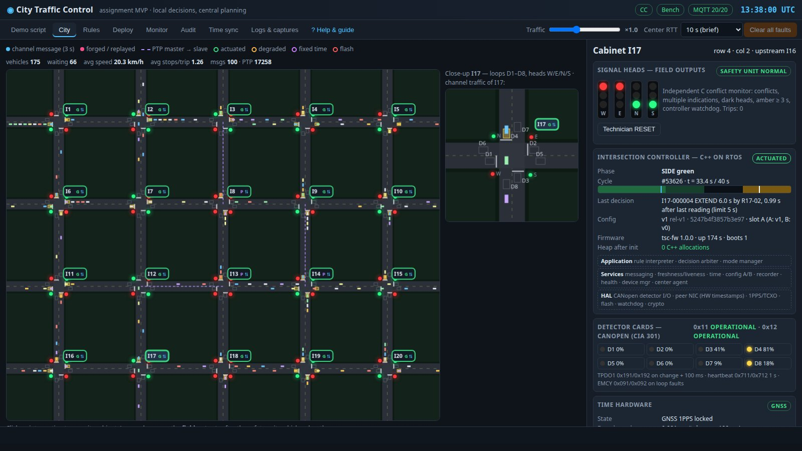

**Contents**
1. [What is running, and how to check it](#1-what-is-running-and-how-to-check-it)
2. [The city: directions, roads and detectors](#2-the-city-directions-roads-and-detectors)
3. [How the lights run: the 40-second cycle](#3-how-the-lights-run-the-40-second-cycle)
4. [Two safety words: conflicting greens and gridlock](#4-two-safety-words-conflicting-greens-and-gridlock)
5. [Rules, explained field by field](#5-rules-explained-field-by-field)
6. [Time synchronisation](#6-time-synchronisation)
7. [From table to traffic light: define, validate, release, deploy, activate](#7-from-table-to-traffic-light-define-validate-release-deploy-activate)
8. [Watching it live: telemetry, logs and communication](#8-watching-it-live-telemetry-logs-and-communication)
9. [Fault injection: what changes, and where you see it](#9-fault-injection-what-changes-and-where-you-see-it)
10. [Where every file is](#10-where-every-file-is)
11. [Platform and limitations](#11-platform-and-limitations)
12. [Glossary](#12-glossary)

---

## 1. What is running, and how to check it

### 1.1 Start, stop and status

Everything is started and stopped with one script, from the project folder:

```bash
./demo.sh setup      # once: fetch Mosquitto, build the C/C++ programs, create certificates and keys, rules repository, release v1
./demo.sh start      # start broker + control center + testbench (which starts 20 controllers + 20 safety units)
./demo.sh status     # are they running?
./demo.sh stop       # stop everything
./demo.sh reset      # stop, wipe runtime data, re-create release v1 (a clean baseline)
./demo.sh test       # unit tests + 8-minute end-to-end self-test (37 checks)
./demo.sh sub        # print live MQTT traffic in the terminal
./demo.sh tail 17    # follow the log of controller I17
```

Then open **http://127.0.0.1:8080** in a browser.

`./demo.sh status` prints:

```text
  broker: running (pid 722213)
  cc: running (pid 722216)
  bench: running (pid 722233)
  controllers: 20/20   safety units: 20/20
```

### 1.2 The 43 processes

| Process | Program | How many | Started by | What it is in the real world |
|---|---|---|---|---|
| Intersection controller | `controller/build/tsc --id N` (C++17) | 20 | testbench | The computer in each roadside cabinet that runs the lights |
| Safety unit (MMU / conflict monitor) | `controller/build/mmu --id N` (C) | 20 | testbench | An independent box in the cabinet that watches the lamps and forces flashing if anything is unsafe |
| MQTT broker | `third_party/mosquitto/usr/sbin/mosquitto` | 1 | `demo.sh` | The message hub at the city's back office |
| Control center | `python3 -m uvicorn control_center.server:app --port 8080` | 1 | `demo.sh` | The back-office server: rule editor, validation, signing, deployment, monitoring, audit |
| Testbench | `python3 testbench/bench.py` | 1 | `demo.sh` | Not part of the product: it simulates the street, the vehicles, the detector cards, the network cables and the GPS sky, and lets you inject faults |

**How the control center process is created.** `demo.sh start` runs
`python3 -m uvicorn control_center.server:app --host 127.0.0.1 --port 8080` in the background. It
writes its process id to `runtime/pids/cc.pid` and its output to `runtime/logs/procs/cc.out`.
Uvicorn is the web server; `control_center/server.py` is the application. At start-up it opens an
MQTT connection with its own client certificate (`CN=control-center`) and starts a 1-second time
beacon. The testbench starts the 40 cabinet programs itself and restarts a controller 2 s after a
crash, like a cabinet rebooting.

**Checking processes in a terminal (Linux):**

```bash
./demo.sh status                                   # summary
pgrep -af controller/build/tsc | wc -l             # expect 20
pgrep -af controller/build/mmu | wc -l             # expect 20
pgrep -af "control_center.server|bench.py|mosquitto"
ps -o pid,rss,etime,args -p "$(cat runtime/pids/cc.pid)"
curl -s http://127.0.0.1:8080/api/system | python3 -m json.tool | head   # the same data as the GUI panel
```

**Checking processes in the GUI.** The top of this Help tab shows every process live: process id,
memory, threads, uptime and full command line. The control center reads them from `/proc` every
2 seconds. If you power off a controller with fault injection, its tile turns red here.

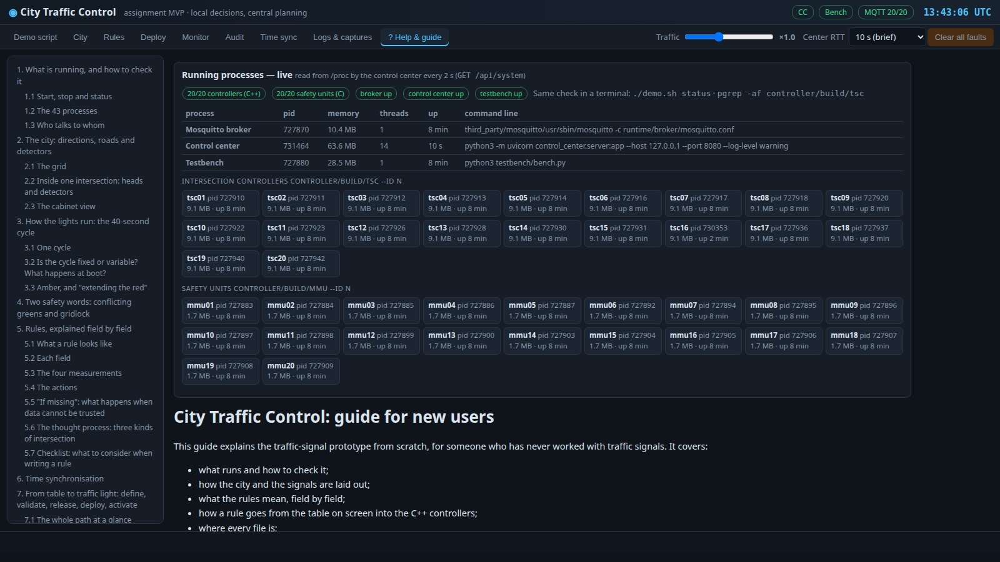

### 1.3 Who talks to whom

```text
                 Control center (Python, :8080) ─── browser GUI (REST + WebSocket)
                        │  MQTT 3.1.1 over mutual TLS (port 8883), via a WAN emulator: 5 s each way
                 Mosquitto broker
                        │
     ┌──────────────────┼──────────────────────── … 20 cabinets
  Cabinet I17
     tsc17 (C++) ── lamp commands + watchdog toggle ──► mmu17 (C) ──► lamps on the street (bench)
       │  ▲                                              │
       │  └─ CANopen frames from 2 detector cards (bench)│ status back to the controller
       └── peer Ethernet: channel messages (UDP multicast, AES-CMAC) and PTP time messages ──► neighbours
```

- **Controller to control center:** MQTT. Health every 2 s, alarms, decision records, configuration
  acknowledgements. The controller always opens the connection (outbound only).
- **Control center to controller:** MQTT. Signed configurations and signed activation commands only.
  The center never sends anything a controller needs in order to make a decision.
- **Controller to controller:** the peer Ethernet network. One 104-byte authenticated message per
  cycle with the 8 detector readings, plus PTP time messages.
- **Controller to its own cabinet:** CANopen frames from the detector cards, lamp commands to the
  safety unit.

---

## 2. The city: directions, roads and detectors

### 2.1 The grid

```text
            column 1   column 2   column 3   column 4   column 5
  row 1  →    I1    →    I2    →    I3    →    I4    →    I5      main road (east-west)
                                     ↓
  row 2  →    I6    →    I7    →    I8    →    I9    →    I10
                                     ↓
  row 3  →    I11   →    I12   →    I13   →    I14   →    I15
                                     ↓
  row 4  →    I16   →    I17   →    I18   →    I19   →    I20
```

- **Main road = east-west** (the rows). **Side streets = north-south** (the columns). Blocks are 110 m.
- **The coordinated direction is eastbound.** A "green wave" lets a group of cars driving east hit
  green after green.
- **Upstream** means "the intersection traffic comes from before it reaches me". Here that is the
  western neighbour. Column 3 is also a north–south feeder road, so I8, I13 and I18 have a second
  upstream to the north.

| Kind | Intersections | Upstream |
|---|---|---|
| Corridor head (no upstream) | I1, I6, I11, I16 | none: traffic enters the city here |
| One upstream (west) | I2, I3, I4, I5, I7, I9, I10, I12, I14, I15, I17, I19, I20 | the western neighbour (I17's is I16) |
| Two upstreams (west + north) | I8, I13, I18 | west and north (I13's are I12 and I8) |

**Which cabinets have no GNSS (GPS) reception?** **I8, I13 and I14**: tall buildings block the sky
(an "urban canyon"). They take their time over PTP from a neighbour (section 6). All the others
have GNSS. The City map marks them with a **P** on the badge (G = GNSS) and draws dashed purple lines
from their PTP master.

### 2.2 Inside one intersection: heads and detectors

Each intersection has **4 signal heads**, one per approach. **W** and **E** serve the main road;
**N** and **S** serve the side street. Each head has red, amber and green.

It has **8 vehicle detectors** (inductive loops cut into the road, which sense the metal of a car
above them). They are numbered D1 to D8:

| Detector | Where it is | What it tells you, in plain words |
|---|---|---|
| **D1** | stop line of the **eastbound** approach (west side) | Are cars waiting/arriving on the main road from the west? |
| **D2** | stop line of the **westbound** approach (east side) | Same for cars coming from the east |
| **D3** | stop line of the **northbound** approach (south side) | Is anyone waiting on the side street from the south? |
| **D4** | stop line of the **southbound** approach (north side) | Same, from the north |
| **D5** | **exit** for eastbound departures (east side) | Are cars leaving eastward, and is the exit backed up? |
| **D6** | exit for westbound departures (west side) | Same, westward |
| **D7** | exit for northbound departures (north side) | Same, northward |
| **D8** | exit for southbound departures (south side) | Same, southward |

**Stop-line** detectors (D1–D4) sit just before the white line where cars stop: they see the queue.
**Exit** detectors (D5–D8) sit just after the intersection: they see cars leaving. If an exit
detector is covered for a long time, the road after the intersection is full.

The detectors are read by **two CANopen detector cards** in the cabinet: node **0x11** reads D1–D4
and node **0x12** reads D5–D8. (CANopen is a standard industrial field bus; in the real cabinet it
is a CAN cable.)

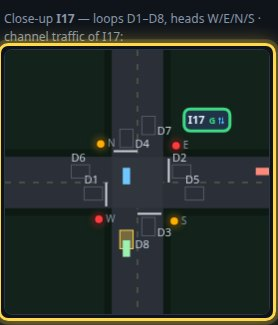

The close-up shows the selected intersection. Grey rectangles are the loops; they turn yellow while
a car is over them. The dots by each stop line are the head colours. Below it is a live feed of
every channel message this intersection received ("`ch16 seq 27 I16 → I17 (3 s)`").

### 2.3 The cabinet view

Click any intersection to open its cabinet on the right. Top to bottom:
- **Signal heads:** the lamps actually lit on the street after the safety unit, and the safety unit's
  status.
- **Intersection controller:** mode, phase, position in the 40 s cycle, last decision, active
  configuration and slot, and "0 C++ allocations" (proof of no dynamic memory after start-up).
- **Detector cards:** both CANopen nodes and the 8 loop LEDs with occupancy or fault.
- **Time hardware:** GNSS, PTP, the crystal, and the real clock error.
- **Peer network:** which channels it listens to, message age, sequence numbers, losses, security
  counters, and the 10-slot message buffer.
- **Center link:** MQTT status and the store-and-forward backlog.
- **Fault injection:** buttons for every fault (section 9).

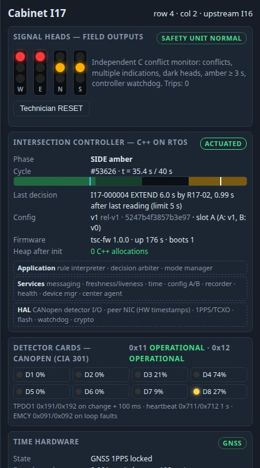 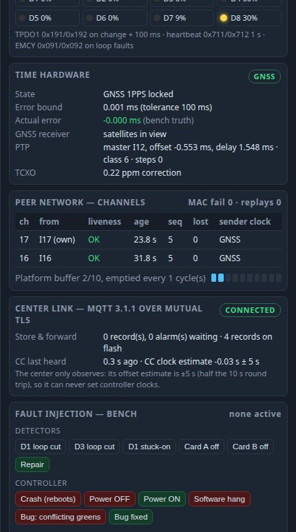

---

## 3. How the lights run: the 40-second cycle

### 3.1 One cycle

Every intersection repeats the same **40-second cycle**. The cycle length never changes. What
changes is **how the 40 seconds are split** between the main road and the side street.

```text
 t = 0 s          13 s 14 s           ≤ 22 s                                              35 s        40 s
     ├── MAIN green ──┼──┼─ +0…8 s ─────┤ amber 3 s │ all-red 2 s │── SIDE green 8…16 s ──┤ amber 3 s │ all-red 2 s ┤
                      │  └ DECIDE: extend the main green, or not?
                      └ sample all 8 detectors, send them to the neighbours
```

| Period | Length | Notes |
|---|---|---|
| Main green (W/E heads) | 14 s minimum, plus 0–8 s extension = **14 to 22 s** | the extension is what the rules decide |
| Main amber | 3 s, fixed | |
| All red | 2 s, fixed | every head red: clears the box before the cross traffic starts |
| Side green (N/S heads) | the rest: **16 s** without extension, **8 s minimum** with the full 8 s extension | |
| Side amber | 3 s, fixed | |
| All red | 2 s, fixed | |

**The side street is skipped when nobody is waiting.** If D3 and D4 (the side-street stop-line
detectors) see no car, the main road simply stays green. A broken side-street detector counts as
"someone is waiting", so a side street is never starved.

**The green wave.** All 20 controllers count the same 40-second cycle on synchronised clocks. Each
column starts its cycle **8 seconds later** than the column to its west (offsets 0, 8, 16, 24, 32 s),
because a car at 50 km/h needs about 8 s for a 110 m block. A car that gets green at I16 therefore
arrives at I17 just as I17's green starts.

Each controller works out its place in the cycle from the time itself:
`cycle number = floor((UTC − offset) / 40 s)`. That is why correct time matters (section 6).

### 3.2 Is the cycle fixed or variable? What happens at boot?

The **cycle length is fixed at 40 s** for every intersection in this prototype. The **split varies**
with traffic (main green 14–22 s, side 8–16 s or skipped). This is a deliberate simplification: a
common cycle keeps the buffer and current-cycle checks simple and makes the green wave possible.
Cycle length and the other timings are parameters (`TIMING` in `common/city.py`); they are compiled
into every signed configuration.

**At boot** a controller needs no traffic history:
1. It reads its time from GNSS (or from a PTP neighbour). It may set its clock once, before it
   controls any lamp.
2. It loads the signed configuration from its own flash (slot A or B). If there is none or it is
   invalid, it runs a built-in fixed-time plan without rules.
3. It shows **all red for 5 seconds**.
4. It joins the city cycle at the right point, computed from the clock. The first decision uses the
   detector readings of that very cycle. Rules that need an upstream message wait for the first
   message, and until then use their fallback (section 5.5).

The safety unit shows flashing until the controller sends its first valid lamp command.

### 3.3 Amber, and "extending the red"

**Amber and all-red are not controlled by rules, on purpose.** They are safety clearance times:
long enough for a car to stop or clear the box. If a rule could shorten amber, a bad rule could
create a crash. So amber (3 s) and all-red (2 s) are fixed timing parameters. The independent
safety unit trips if any amber is shorter than 2.7 s. Making amber longer per intersection (for
example for a fast road) can be added easily as a validated timing parameter. It should not become
a rule action.

**"Extending the red."** At a two-phase intersection, the main road's red is simply the side
street's green plus clearances. So "extend red on the main road" means "give the side street more
time", which is what happens when **no** extension rule fires: the side street then gets its full
16 s. The rules therefore only need two kinds of action: extend the main green, or do not.

---

## 4. Two safety words: conflicting greens and gridlock

**Conflicting greens.** Two traffic streams whose paths cross get green (or amber) at the same time,
for example the main road W/E and the side street N/S together. Cars would meet in the middle. This
is the most dangerous failure of a traffic signal. It is prevented twice:
1. **The controller** only ever runs the sequence main green → amber → all-red → side green →
   amber → all-red. Rules cannot change that order; they only change how long the main green lasts.
2. **The independent safety unit** (`mmu/mmu.c`, a separate program sharing no code) looks at the
   lamps actually lit. If W/E and N/S show green or amber together for 150 ms, it cuts the lamp
   drivers and switches to **flashing** (amber main, red side). It stays flashing until a
   technician presses RESET. It also checks two lamps on one head, a dark head, an amber that was
   too short, and the controller's watchdog signal (1 s).

**Gridlock.** Cars enter the intersection but cannot leave, because the road after it is full.
They stay in the box and block the cross street when it gets green. Then that street backs up into
the next intersection, and the jam spreads across the grid. The rule against it is "don't block the
box". In this prototype, every intersection has a **gridlock guard** rule: if the exit detector D5
is covered more than 60 % of the time, the road after the intersection is backed up, so the
controller must **not** extend the main green. Extra green would only push more cars into a box they
cannot leave. It gets the highest priority, so it overrides "a platoon is coming".

---

## 5. Rules, explained field by field

### 5.1 What a rule looks like

In the GUI a rule is a row in a table. It is stored as this readable text, one block per rule,
in a Git repository (`runtime/rules_repo/I17.rules`):

```ini
[R17-02]
title      = Extend main green for an approaching platoon
where      = intersection 17, phase main
when       = upstream 16 D5 gap < 3 s
then       = extend green by 6 s
if-missing = do not extend
priority   = 20
```

Read it aloud: *"At intersection 17, during the main-road green: **when** cars are still leaving
intersection 16 eastward less than 3 seconds apart, **then** keep the main green 6 seconds longer.
**If** that information is missing, do not extend. This rule has priority 20."*

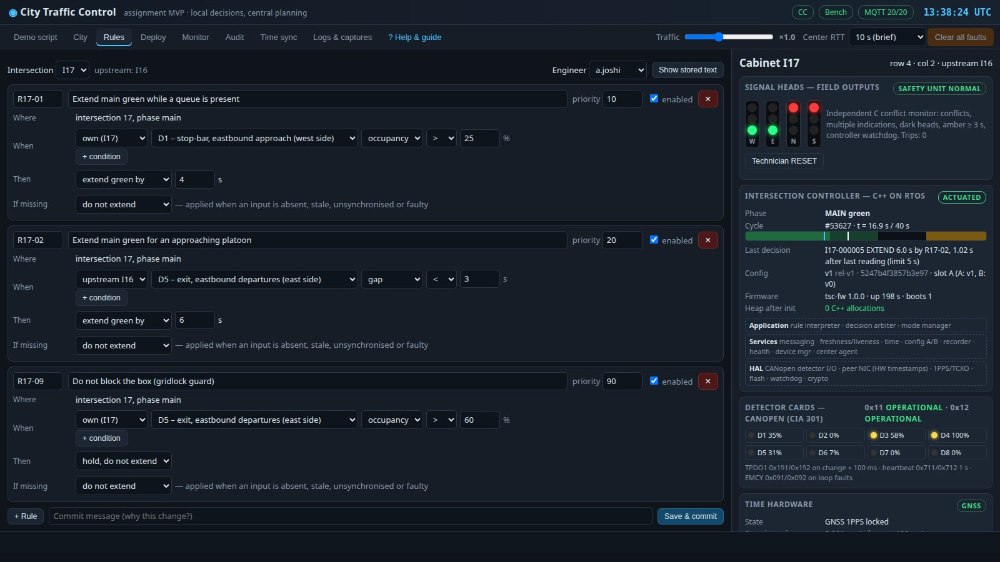

### 5.2 Each field

| Field | Meaning | Allowed values |
|---|---|---|
| **id** (`[R17-02]`) | Name of the rule; appears in every decision record | unique per intersection |
| **title** | A sentence for humans: why the rule exists | free text |
| **where** | Which intersection and which phase the rule belongs to | always `intersection N, phase main`: rules decide only the main green |
| **when** | The condition that makes the rule "fire" | `<source> D<n> <measure> <operator> <value> <unit>` |
| **and** | Optional extra conditions; all must be true | up to 3 conditions per rule |
| **then** | What to do when it fires | `extend green by X s` · `hold, do not extend` |
| **if-missing** | What to do when an input cannot be trusted (see 5.5) | `do not extend` · `extend green by X s` · `hold, do not extend` |
| **priority** | Which rule wins if several want something (higher wins) | number; two rules with the same priority must want the same thing |
| **enabled** | Switch a rule off without deleting it | yes / no |

The **source** in a condition is `own` (this intersection's detectors) or `upstream N` (a detector of
upstream intersection N, received over the peer network).

### 5.3 The four measurements

Every detector is measured over the **last 10 seconds**, at second 13 of the cycle.

| Measure | Plain meaning | Example | Typical use |
|---|---|---|---|
| **occupancy** (%) | How much of the last 10 s a car was standing or driving over the loop | 25 % = covered 2.5 s out of 10 s. 100 % = a car has been sitting on it the whole time (a queue) | Queues at a stop line (D1 > 25 %); a backed-up exit (D5 > 60 %) |
| **gap** (s) | Seconds since the last car **left** the loop. 0 means a car is on it right now | gap 0.8 s = cars are passing in a stream. gap 12 s = the road is empty | A platoon leaving upstream (upstream D5 gap < 3 s) |
| **count** (vehicles) | How many cars arrived on the loop in the last 10 s | count 4 = four cars | How busy a feeder road is (north D8 count < 4) |
| **presence** (0/1) | Is a car on the loop right now? | 1 = yes | Simple demand checks |

**Operators:** `>` greater than, `>=` at least, `<` less than, `<=` at most, `==` equal.
**Units:** `%` for occupancy, `s` for gap, `veh` (vehicles) for count, none for presence.

So `own D1 occupancy > 25 %` means: "the eastbound stop-line loop at this intersection was covered
more than 2.5 of the last 10 seconds", i.e. a queue is still clearing.

### 5.4 The actions

- **extend green by X s.** Keep the main green X seconds longer than the 14-second minimum. The
  maximum is **8 s** (main green up to 22 s), so the side street always keeps at least 8 s. The
  validator rejects a rule asking for more, and the controller caps it as a second line of defence.
- **hold, do not extend.** Actively **forbid** extension this cycle, even if lower-priority rules
  want one. Used by the gridlock guard.
- **do not extend** (only as an if-missing choice). "This rule has no opinion": it steps aside and
  lets lower-priority rules decide. If no rule wants anything, the main green ends at 14 s.

**How the winner is chosen** (the arbiter): the controller goes through the rules from highest to
lowest priority. The **first rule that wants an action** (extend or hold) decides. Rules that did not
fire, or that "do not extend" because of missing data, are skipped. Example at I13:

| Rule | Priority | This cycle | Wants |
|---|---|---|---|
| R13-09 gridlock guard: own D5 occupancy > 60 % | 90 | occupancy 21.7 % → not fired | nothing |
| R13-02 platoon: I12 D5 gap < 3 s **and** I8 D8 count < 4 | 20 | gap 0.4 s, count 0 → fired | extend 6 s |
| R13-01 queue: own D1 occupancy > 25 % | 10 | (not reached) | |

Result: **EXTEND 6 s by R13-02**. The main green lasts 20 s. This is exactly the trace shown in the
Audit tab (section 8.4).

### 5.5 "If missing": what happens when data cannot be trusted

An input is **missing** when it exists but cannot be trusted for this cycle. The reason is written
into the decision record. Typical reasons:
- the detector is faulty (loop cut, stuck on, card silent);
- the upstream controller is silent (no message this cycle) or was just restarted (it needs 2 good
  cycles before it is trusted again);
- the reading is from the **previous** cycle (the core requirement: only **current-cycle** data);
- the sender's or the receiver's clock is not synchronised;
- the message's timestamp does not match its arrival (a clock is drifting).

Then the rule does not evaluate its condition. It applies its **if-missing** choice instead:
- **do not extend.** The safe default, used by all baseline rules: without information, behave like
  the background fixed timing. When an upstream neighbour fails, this is what "falling back to fixed
  timing" means, rule by rule. The intersection's mode shows **DEGRADED**.
- **extend green by X s.** For a road you want to favour when in doubt (for example a bus route).
- **hold, do not extend.** For caution: "if I cannot see the exit, do not push more cars into it".

If the intersection loses its **own** stop-line detection (both detector cards silent, or 3 of the
4 stop-line loops failed), it stops using rules entirely. It runs a **local fixed-time plan**
(mode **FIXED_TIME**: main green 18 s, side street always served).

### 5.6 The thought process: three kinds of intersection

The baseline rules for all 20 intersections were **generated from one template**
(`default_rules()` in `common/rules.py`), using the city map. They were not hand-typed one by one.
The order of writing does not matter to the controllers: each runs only its own table. The natural
order for a person is **west to east, following the traffic**, because each rule refers to the
intersection traffic comes from.

**a) No upstream: I1, I6, I11, I16 (corridor heads).** Nothing arrives from a controlled
intersection, so only local rules make sense:

```ini
[R1-01]  when own D1 occupancy > 25 %  then extend green by 4 s  if-missing do not extend  priority 10
[R1-09]  when own D5 occupancy > 60 %  then hold, do not extend  if-missing do not extend  priority 90
```

*"If the queue on my main road is still clearing, give it 4 more seconds. But never extend if my own
exit is backed up."*

**b) One upstream: for example I17 (upstream I16).** Add a **platoon rule**: look at the exit loop
of the intersection before you (I16's D5, eastbound departures):

```ini
[R17-02]  when upstream 16 D5 gap < 3 s  then extend green by 6 s  if-missing do not extend  priority 20
```

Why this works:
- I16 measures its exit at its second 13. Because of the 8 s offset, that is second 5 of I17's cycle.
- The message takes up to 3 s, so it arrives at I17 around second 8, well before I17 decides at
  second 14.
- If cars are still streaming out of I16 (gap below 3 s), they will reach I17 in about 8 s, during
  I17's green.
- Six more seconds lets them through without stopping.

That is the green wave kept alive by measured traffic instead of a fixed plan.

**c) Two upstreams: for example I13 (upstream I12 from the west, I8 from the north).** Combine both
in one rule:

```ini
[R13-02]  when upstream 12 D5 gap < 3 s  and upstream 8 D8 count < 4 veh
          then extend green by 6 s  if-missing do not extend  priority 20
```

*"Extend for the platoon from the west, unless the north feeder is busy."* If 4 or more cars came
down from I8 in the last 10 s, the side street at I13 needs its time, so the main road should not
take it.

Timing note: I8 is in the same column as I13, so it samples at the **same** second 13, and its
message arrives around second 16, after the normal decision time of 14 s. The controller then
**holds the green, at most 2.5 s**, waiting for that in-flight message, and decides at about
second 16. The validator checks that this wait and the 5-second deadline still hold.

### 5.7 Checklist: what to consider when writing a rule

1. **Purpose first.** Queue clearing, platoon progression, or protection (gridlock). Write it in the
   title.
2. **Use the right detector.** Stop-line loops (D1–D4) see queues; exit loops (D5–D8) see departures
   and blockages. Upstream: use the upstream's exit loop that points at you (D5 from the west, D8
   from the north).
3. **Only real upstream neighbours.** The validator rejects a source that is not upstream.
4. **Keep inside the limits.** Extension ≤ 8 s; at most 16 rules and 3 conditions per rule.
5. **Choose the fallback consciously.** What should happen if the detector or the neighbour fails?
6. **Protection beats progression.** Give gridlock guards the highest priority. Two rules at the same
   priority must not want different things.
7. **Deadlines and freshness.** A decision that uses upstream data must be taken within 5 s of the
   oldest reading it uses (2 s for local only). The upstream reading must be from the current cycle.
   The validator computes this from the offsets.
8. **Message budget.** Every upstream you use adds a message per cycle to the 10-slot buffer. The rule
   is messages × (N + 1) ≤ 10, where N = how often the buffer is emptied.
9. **Try it on real data.** Use **Replay** to see which recorded decisions your edit would change,
   before anyone approves it.

---

## 6. Time synchronisation

All decisions depend on every controller agreeing on the time to within **100 ms** (the target from
the assignment). The cycle position comes from the clock, and every reading carries a timestamp.

| Tier | Source | Who uses it here | If it fails |
|---|---|---|---|
| 1 | **GNSS** receiver with a pulse-per-second output | 17 cabinets with sky view | fall to tier 2 |
| 2 | **PTP** (IEEE 1588) from a neighbour over the peer network | **I8, I13, I14** (no sky view), and any cabinet whose GNSS fails | fall to tier 3 |
| 3 | **Holdover** on the cabinet's temperature-compensated crystal (TCXO, 2 ppm) | anyone who lost both | stays within 100 ms for about 13.9 hours |

Rules the time service follows:
- The clock is set (stepped) only once, at start-up. After that it is only sped up or slowed down,
  so a cycle never jumps.
- A GNSS time jump that a PTP neighbour disagrees with is rejected as **spoofing**.
- **The control center never sets clocks.** Its link has a 10 s round trip, so it can only estimate a
  controller's clock to ±5 s. It shows that estimate in the Monitor tab and raises an alarm.

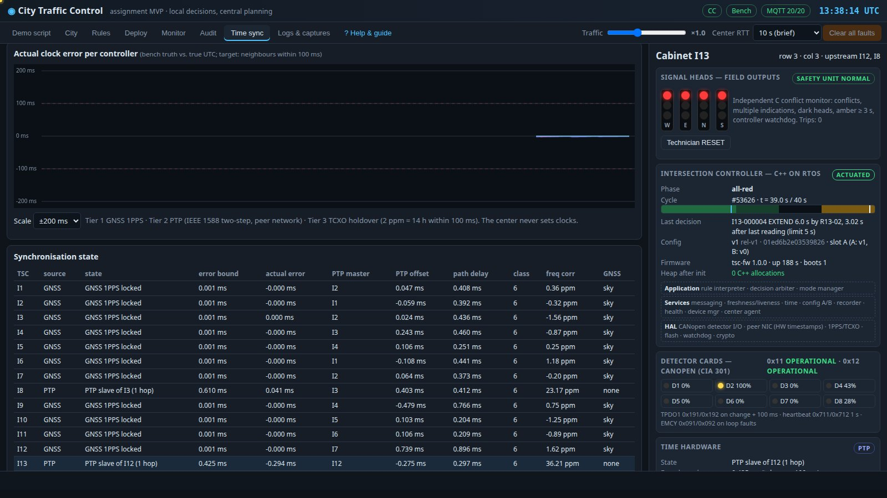

---

## 7. From table to traffic light: define, validate, release, deploy, activate

### 7.1 The whole path at a glance

| Step | Where you do it | What is created | Where it is stored | When |
|---|---|---|---|---|
| 1. **Define** | Rules tab: edit the table, write a commit message, **Save & commit** | readable rule text, a Git commit by the selected engineer | `runtime/rules_repo/INN.rules` (a Git repository) | immediately on Save |
| 2. **Validate** | Rules tab, **Validate all** | a report only; nothing is written | shown in the GUI | on click |
| 3. **Replay** | Rules tab, **Replay recorded cycles** | a comparison only | shown in the GUI | on click |
| 4. **Release** | Rules tab, **Compile, sign & release** (author + a *different* approver) | one binary, signed configuration per controller, a manifest, a Git tag | `runtime/cc/releases/vN/tscNN.cfg`, `manifest.json`, tag `rel-vN` | on click |
| 5. **Deploy (stage)** | Deploy tab, **Deploy to changed** or **all 20** | MQTT message with the .cfg bytes | controller flash: inactive slot `runtime/flash/tscNN/slot_B.cfg` (or A) | on click, ~5 s to arrive |
| 6. **Activate** | automatic, after every target acknowledged | signed activation command with a time T | controller switches its `active_slot` | at each controller's first cycle boundary after T |

Nothing reaches a controller until step 5. Nothing changes on the street until step 6.

### 7.2 Define

Pick the intersection and your name (Engineer), change the table, write *why* in the commit
message, and press **Save & commit**. The control center turns the table into the rule text, writes
`runtime/rules_repo/I17.rules`, and commits it to Git with you as author. The GUI shows the diff and
the Git history.

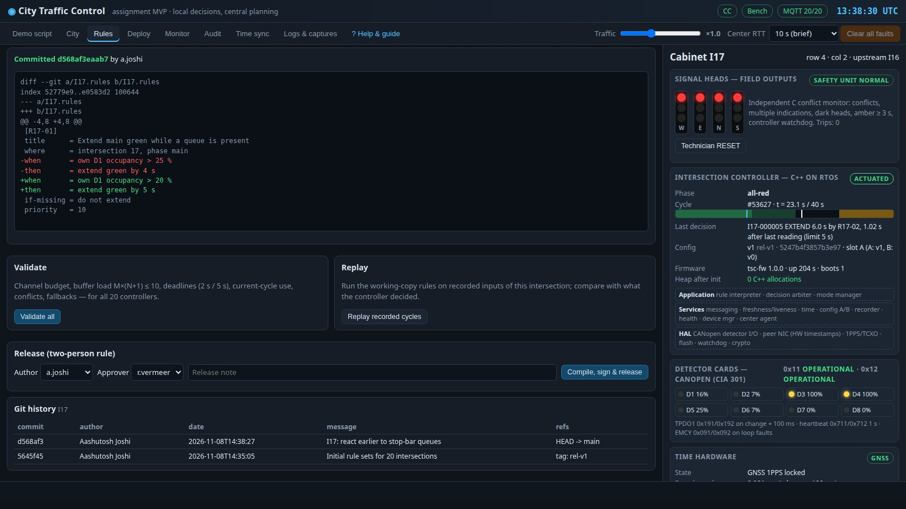

### 7.3 Validate and replay

**Validate all** checks every one of the 20 intersections, because one intersection's rules affect
the messages its neighbours must send. It checks:
- syntax and the interpreter limits (16 rules, 3 conditions);
- that every detector exists and every value is in range;
- that the source is a real upstream neighbour;
- that every rule has a fallback;
- the 8-second extension limit;
- priority conflicts;
- the buffer load (messages × (N+1) ≤ 10);
- the decision deadline (2 s local, 5 s upstream);
- that every upstream reading is from the current cycle;
- the channel budget (20 of 100 channels used, 20 reserved for future pedestrian sensors).

A release is refused unless validation passes.

**Replay** runs your edited rules on the inputs the controller actually recorded, and lists which
decisions would change. It also checks that the center's Python evaluator agreed with the
controller's C++ interpreter on every recorded cycle.

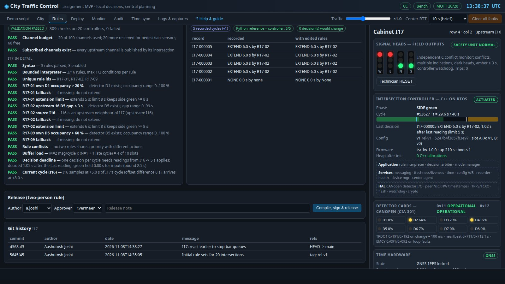

### 7.4 Release: compile and sign, with two people

A release needs **two different engineers**: an author and an approver. If you try to approve your
own change, it is refused:

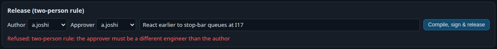

With a second engineer, the control center:
1. validates all 20 rule sets again and checks that everything is committed;
2. **compiles** each intersection's rules into a fixed binary table;
3. **signs** it with the Ed25519 signing key (`runtime/cc/hsm/config_signing.key`; a key file stands in
   for a hardware security module);
4. writes `runtime/cc/releases/vN/tscNN.cfg` for all 20, plus `manifest.json` (which intersections
   changed, hashes, author, approver);
5. tags the Git commit `rel-vN`, with the approver as tagger.

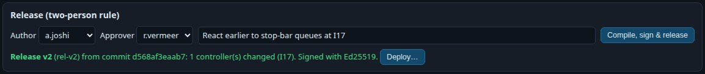

### 7.5 The file the controller receives

It is **not code and not byte code**. It is a small fixed-layout **data table** (rules are data,
not code). The controller's interpreter loops over it. A configuration with 3 rules is **384 bytes**:

```text
| 128-byte header | 64 bytes per rule (up to 16) | 64-byte Ed25519 signature |
  "TSCF", format, intersection, version, release tag, Git commit, own channel, buffer N,
  subscribed channels, upstream ids, 15 timing values in ms (cycle 40000, offset, min green 14000,
  max extension 8000, side min 8000, amber 3000, all-red 2000, sample at 13000, …)
  rule: id, number of conditions, action, if-missing, action ms, missing ms, priority,
        3 × condition {source intersection, detector, measure, operator, value × 1000}
```

Decode any of them with `python3 tools/cfg_dump.py <file>`. Real output for I13:

```text
runtime/cc/releases/v1/tsc13.cfg: 384 bytes = 128 header + 3 x 64 rule + 64 signature
  magic TSCF  format 1  intersection I13  version 1  tag rel-v1  git 7caee36cb293
  own channel 13  buffer emptied every 1 cycle(s)  subscribes [13, 8, 12]  upstream [8, 12]
  timing (ms): cycle 40000, offset 16000, main_min 14000, main_max_ext 8000, side_min 8000, amber 3000, allred 2000, ...
  rule R13-09   priority  90  when I13 D5 occupancy > 60  then hold, do not extend  if missing do not extend
  rule R13-02   priority  20  when I12 D5 gap < 3 and I8 D8 count < 4  then extend green by 6 s  if missing do not extend
  rule R13-01   priority  10  when I13 D1 occupancy > 25  then extend green by 4 s  if missing do not extend
  Ed25519 signature: VALID (runtime/pki/config_signing.pub)
```

Rules are stored highest priority first, so the controller can stop at the first rule that wants an
action. Layout in code: `HEADER_FMT`, `RULE_FMT` and `CLAUSE_FMT` in `common/rules.py`
(writer) and `parse_config()` in `controller/src/services/config_store.cpp` (reader).

### 7.6 Deploy: what goes over MQTT

In the **Deploy** tab press **Deploy to changed** (only intersections whose rules changed) or
**all 20**.

| # | Topic | Direction | Payload | QoS |
|---|---|---|---|---|
| 1 | `center/tsc17/cfg/stage` | center → I17 | the **binary .cfg file bytes** (384 B), exactly as in the release folder | 1 (delivered at least once, queued while offline) |
| 2 | `field/tsc17/cfg/ack` | I17 → center | JSON, e.g. `{"op":"stage","ok":true,"result":"STAGED v2 in slot B (signature OK, hash …)","active":1,"slot_a":1,"slot_b":2}` | 1 |
| 3 | `center/tsc17/cfg/cmd` | center → I17 | 84-byte activation command: `TSCA`, intersection, operation (1 activate / 2 roll back), version, time T in UTC ns, plus Ed25519 signature | 1 |
| 4 | `field/tsc17/cfg/ack` | I17 → center | `{"op":"cmd","ok":true,"result":"ACTIVATION of v2 scheduled at … (first cycle boundary after)",…}` | 1 |
| 5 | `field/tsc17/cfg/activated` | I17 → center | `{"ver":2,"scheduled_ns":…,"after_schedule_s":35.0,"cycle":…}` plus an alarm `CFG_ACTIVE` | 1 |

Before accepting anything, the controller checks:
- the signature;
- that the file is for **this** intersection;
- that the version is **newer** than the active one (anti-rollback).

It writes the file into its **inactive slot**; the running configuration is untouched. If even one
target rejects or does not answer within 45 s, the deployment is **aborted** and nothing is
activated anywhere.

### 7.7 Activation: when do the controllers switch?

When every target has acknowledged, the center chooses one activation time **T = now + 20 s**. The
20 s covers the 10-second round trip of the center link. It sends T to all targets in the signed
command.
- **Each controller switches at its own first cycle boundary after T**, on its synchronised clock.
  Never in the middle of a cycle.
- The columns' cycles start 8 s apart, so the switches happen within one 40-second window after T,
  **all in the same cycle** (not at the same second).
- A controller that was offline gets the configuration when it reconnects (shown as a late join).
- The previous version stays in the other slot. **Roll back** (Deploy tab) sends a signed command to
  switch back, again at a cycle boundary.

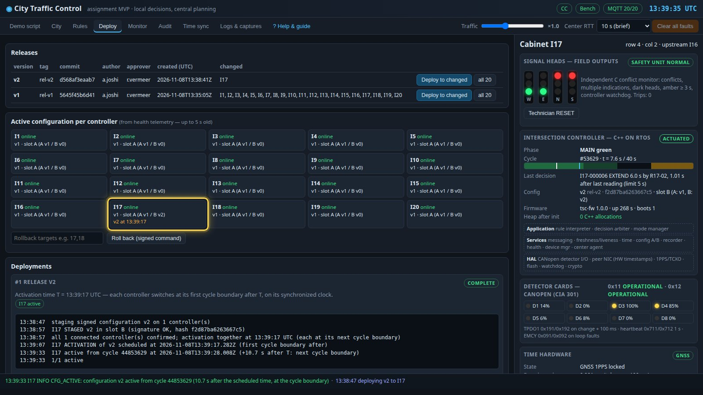

The controller's log shows each step (`./demo.sh tail 17`):
```text
[CFG  ] STAGED v2 in slot B (signature OK, hash …)
[CFG  ] ACTIVATION of v2 scheduled at … (first cycle boundary after)
[CFG  ] ACTIVE v2 (rel-v2) from slot B, hash …
```

### 7.8 How the C++ controller runs it

- At boot, and at each activation, `parse_config()` copies the verified bytes into a fixed C++
  structure: arrays of 16 rules × 3 conditions, with no dynamic memory.
- Every cycle at second 14, `try_decide()` in `controller/src/app/phase_controller.cpp`:
  1. collects the inputs the rules need;
  2. looks each one up (`MessageService::lookup`: current cycle? synchronised? plausible?);
  3. calls `evaluate()` in `controller/src/app/rule_interpreter.cpp`, the interpreter plus
     arbiter, 75 lines;
  4. sets the main-green end;
  5. writes the decision record.

---

## 8. Watching it live: telemetry, logs and communication

### 8.1 In the GUI

| Tab | What you see |
|---|---|
| **Demo script** | 14 guided scenarios with one-click fault buttons and what to expect |
| **City** | Vehicles, lamps, **blue dots = channel messages** flying between controllers (red = forged/replayed), dashed PTP lines, mode ring per intersection; the close-up and its message feed |
| **Rules / Deploy** | Section 7 |
| **Monitor** | What the **control center** knows over MQTT: link, telemetry age, mode, sync, detectors, neighbours, buffer, security counters, config version and slot, safety-unit state, backlog. Below it, **every alarm** with how late it arrived |
| **Audit** | Every decision record. Click one for the full explanation |
| **Time sync** | Real clock error per controller and the source of each |
| **Logs & captures** | Any log file streamed live (filterable), plus packet captures to download |
| **? Help & guide** | This guide and the live process list |

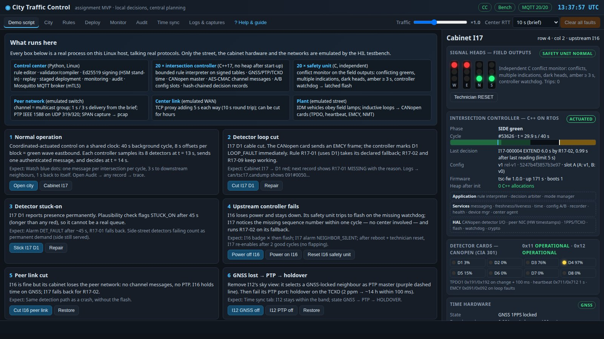

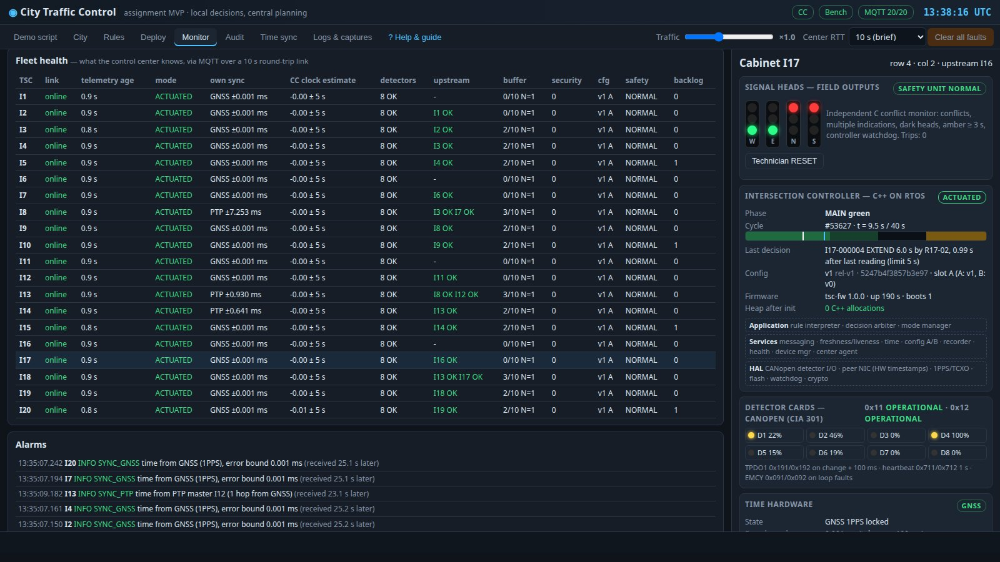

### 8.2 Logs and captures on disk

| File | What is in it |
|---|---|
| `runtime/logs/tscNN.log` | Controller log, tagged `[TIME] [GNSS] [PTP] [CAN] [CHAN] [RULE] [PHASE] [MODE] [CFG] [MQTT] [ALARM]` |
| `runtime/logs/mmuNN.log` | Safety unit: trips and technician resets |
| `runtime/logs/can/tscNN.candump` | Every CANopen frame of the cabinet in `candump -L` format, e.g. `(1794144959.055727) can0 191#02F94E7A5FBB` (TPDO1 from card 0x11) |
| `runtime/logs/nmea/tscNN.nmea` | GNSS receiver sentences, e.g. `$GPRMC,133559.00,A,5200.6960,N,00421.4260,E,…*53` |
| `runtime/logs/mosquitto.log` | Broker: TLS connections, every PUBLISH, last-will messages |
| `runtime/logs/cc.log`, `testbench.log` | Control center and bench events |
| `runtime/logs/pcap/peer_network.pcap` | Every peer-network frame (channel messages UDP 47100, PTP UDP 319/320). Open in Wireshark and add `tools/wireshark/tsc_channel.lua` to decode channel messages |
| `runtime/logs/pcap/can_tscNN.pcap` | Each cabinet's CAN bus (Wireshark decodes SocketCAN natively) |
| `runtime/logs/procs/*.out` | Standard output of every process |

Example controller log lines:

```text
[PHASE] all-red         -> MAIN green      (cycle t=0.0 s)
[RULE ] cycle 44853623 I17-000001 NONE 0.0 s by none, 1.02 s after last reading (limit 5 s) | rules: R17-09 NOT_FIRED, R17-02 NOT_FIRED, R17-01 NOT_FIRED
[PHASE] MAIN green      -> MAIN amber      (cycle t=14.0 s)
```

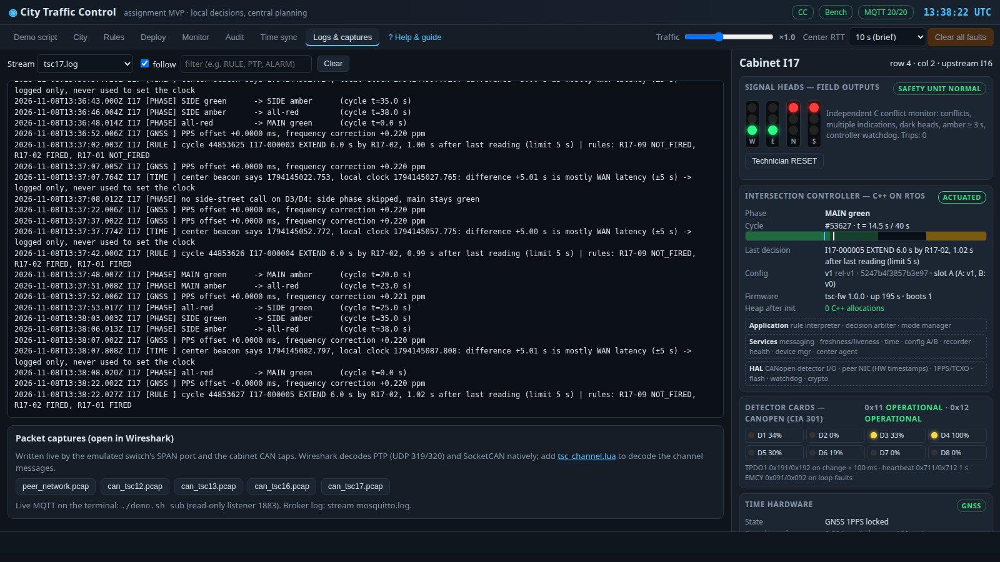

### 8.3 Live MQTT in a terminal

```bash
./demo.sh sub        # read-only listener on port 1883; the controllers themselves use mutual TLS on 8883
```
```text
field/tsc17/status online
field/tsc17/health {"id":17,"fw":"tsc-fw 1.0.0","uptime_s":253,"mode":"ACTUATED","phase":"MAIN green",…}   every 2 s
field/tsc17/records [{"rec":"I17-000012",…,"prev":"…","hash":"…"}]                                         decision records
field/tsc17/alarm {"code":"DET_FAULT","sev":"major","text":"D1 loop open circuit (EMCY 0x5000 …)",…}
center/tsc17/cfg/stage <384 bytes binary>                                                                  deployments
```

All topics, ports and byte layouts are listed in `docs/PROTOCOLS.md`.

### 8.4 Why did it do that? The decision trace

Every decision is a JSON line on the controller's flash (`runtime/flash/tscNN/records.jsonl`). Each
record holds:
- the inputs it used, with sample time, sequence number and age;
- each rule's result;
- the deadline that applied;
- the configuration version and Git commit;
- the hash of the previous record, so records form a chain that cannot be edited without detection.

They are uploaded with QoS 1, and kept on flash while the center is unreachable. The center checks
every hash and the chain, and stores them in `runtime/cc/records.db` (SQLite). In the Audit tab,
click a record:

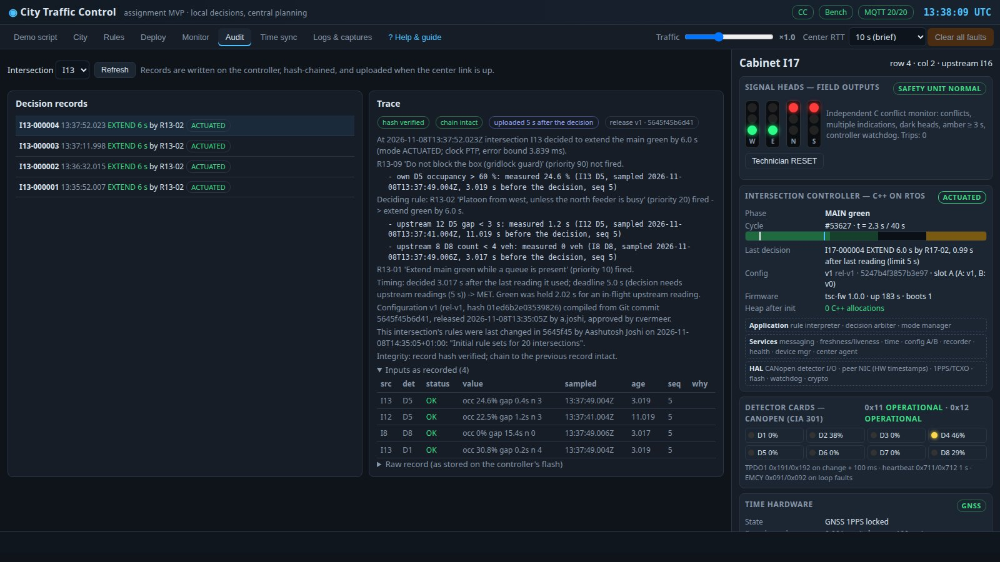

---

## 9. Fault injection: what changes, and where you see it

Every cabinet panel (right side of the City tab) has fault buttons. The **Demo script** tab has the
same faults as guided scenarios. **Clear all faults** (top right) removes them. Safety units stay
latched until a technician reset, as in the field.

| Fault (button) | What the system does | Where you see it |
|---|---|---|
| **D1 loop cut** | The card sends a CANopen emergency frame (EMCY 0x091). D1 becomes LOOP_FAULT; only rules using D1 take their if-missing action; alarm `DET_FAULT` | Cabinet LEDs (red), ticker, Monitor → detectors and Alarms, `tscNN.log` `[CAN]`, `can/tscNN.candump` `091#…` |
| **D1 stuck-on** | After 45 s of constant presence, the plausibility check marks it STUCK_ON; same fallback | Cabinet, alarm `DET_FAULT … STUCK_ON` |
| **Card A off** (node 0x11: D1–D4, all stop-line loops) | Heartbeat stops; after 1.5 s D1–D4 are SILENT. With no stop-line detection left, the controller runs its **FIXED_TIME** plan | Cabinet (card SILENT), alarms `DET_CARD_SILENT`, `MODE_FIXED`, mode chip `FIXED_TIME` |
| **Card B off** (node 0x12: D5–D8, exits) | D5–D8 SILENT; the gridlock guard and the neighbours' platoon rules that use this exit take their fallback | Cabinet, alarm `DET_CARD_SILENT`, neighbours' records |
| **Crash (reboots)** | Process killed; the safety unit sees no watchdog toggle for 1 s and flashes; the bench restarts the controller after 2 s; it boots from its own flash. A technician reset is needed to leave flash | Map ring red, cabinet "Controller not running", Help → process tile, `mmuNN.log` WATCHDOG |
| **Power OFF / ON** | Same, but stays off until Power ON. **Downstream neighbours detect the silence themselves** (next cycle): `NEIGHBOR_SILENT`, upstream rules fall back → **DEGRADED**. After power on, the neighbour is trusted again only after 2 good cycles (`NEIGHBOR_OK`) | I16 flashing, I17 mode DEGRADED, I17 peer table "SILENT", alarms |
| **Software hang** | Main loop stops; the internal watchdog ends the process after 2 s; the safety unit flashes after 1 s | as above, `watchdog reset` in `testbench.log` |
| **Bug: conflicting greens** | The controller commands main and side green together; the **safety unit trips in 150 ms** and flashes | Cabinet "SAFETY UNIT: FLASH – CONFLICT", map flashing, `mmuNN.log` with the lamp word |
| **Weld N-green load switch** | A lamp stays on regardless of the controller; the safety unit detects the unsafe lamp state and its flash relays disconnect the switches | `mmuNN.log`, cabinet |
| **Technician RESET** | Releases a latched safety unit; the controller restarts with 5 s all-red | Cabinet, `mmuNN.log` |
| **GNSS off** | The controller becomes a PTP slave of a neighbour | Time sync tab (source PTP), cabinet time box, alarm `SYNC_PTP` |
| **PTP port off** (with GNSS off) | **HOLDOVER** on the crystal, error bound grows slowly | Time sync tab, alarm `SYNC_HOLDOVER` |
| **TCXO fault 3000 ppm** (isolated) | The clock drifts fast; after a few minutes the receivers call its timestamps implausible and its data "missing" | Time chart drifting, neighbours' records `timestamp implausible` |
| **GNSS spoof +800 ms** | The jump is **rejected** because the PTP peer disagrees | Alarm `GNSS_SPOOF`, Time sync "rejected", real error stays ~0 |
| **Peer link down** | The controller's messages stop; neighbours detect it as silent, as with power off, but without flashing | Neighbours' peer tables, alarms |
| **Center link down** (one or all) | The broker publishes the last will: **offline**. On the street **nothing changes**. Records and alarms queue on flash and upload later with their original timestamps | MQTT pill `0/20`, Monitor link "offline", cabinet backlog; Audit "uploaded … s after the decision" |
| **Forge message / Replay old message** | Forged: the AES-CMAC check fails → dropped, `SEC_MAC`. Replayed: sequence not newer → dropped, `SEC_REPLAY`. Decisions unaffected | Red dots on the map, cabinet "MAC fail / replays", Monitor security column |
| **Previous-cycle upstream ON** / **Buffer N=4** | Re-creates the original proposal for comparison: old data is used (audit flags "PROPOSAL MODE"), or the 10-slot buffer overflows and messages are lost silently (detected only by sequence gaps, `MSG_LOSS`) | Audit, alarms |
| **Traffic slider / Center RTT** | More or less traffic; 10 s (brief) or 1 s round trip to the center | everywhere |

Screenshots of the main cases:

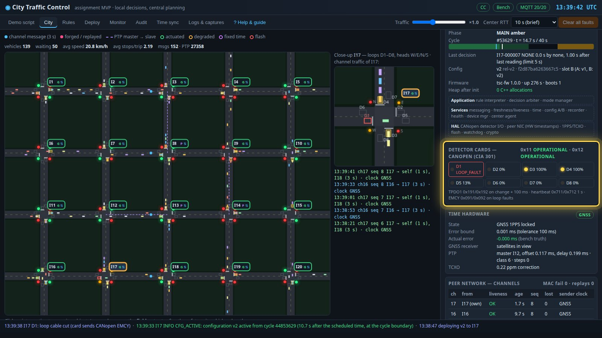
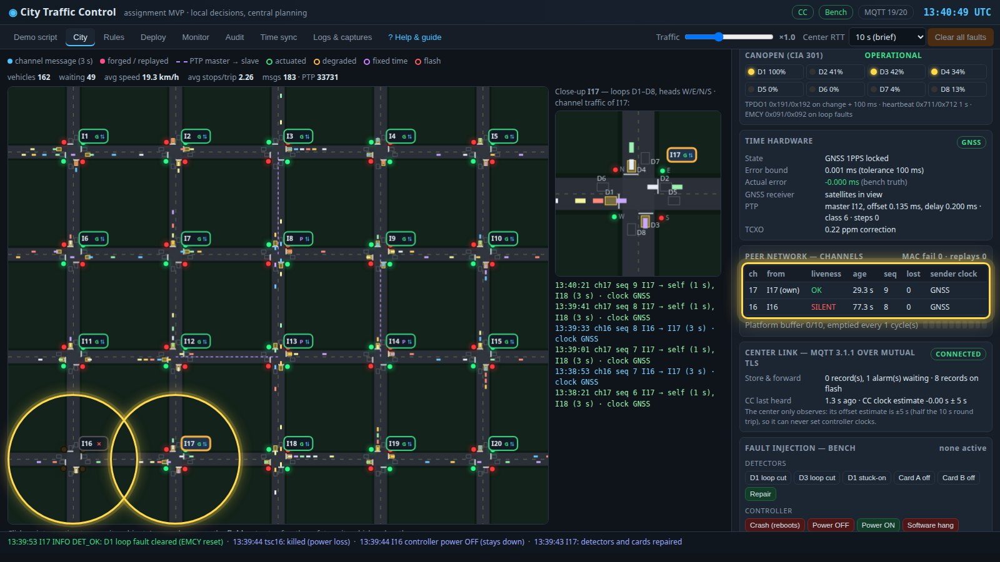
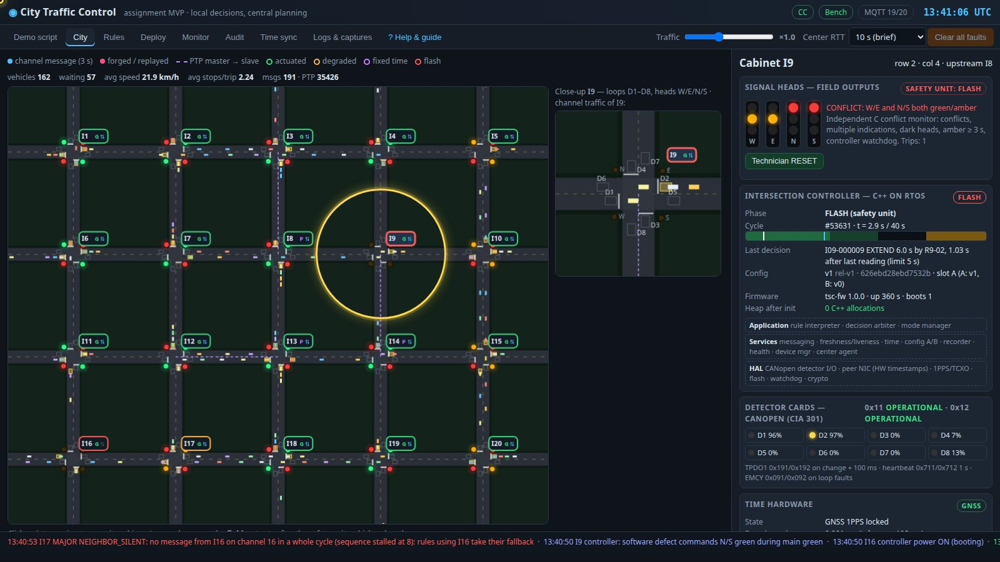
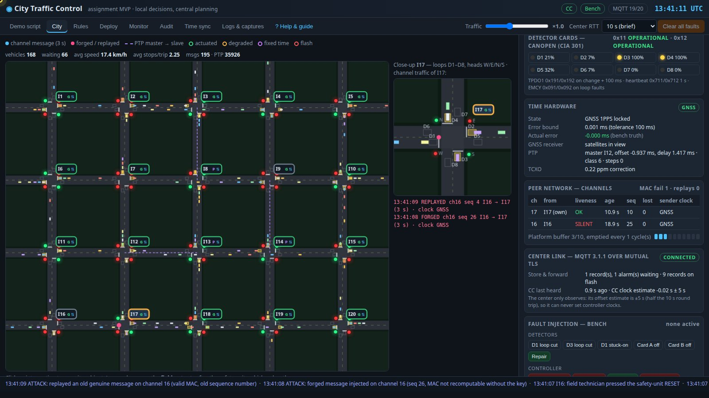
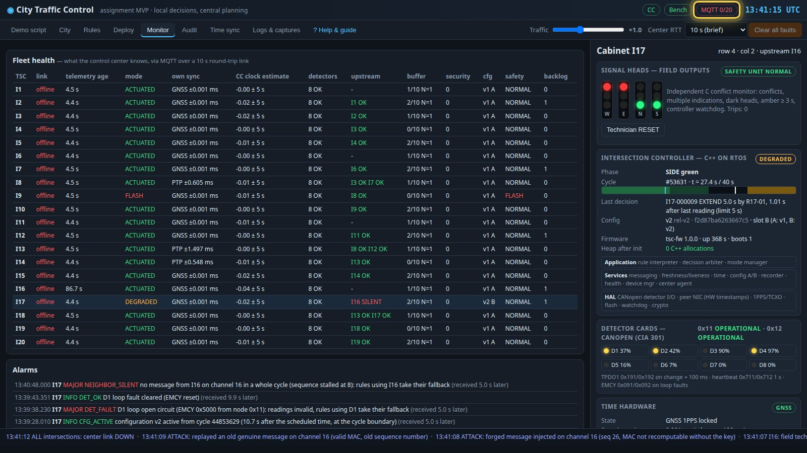
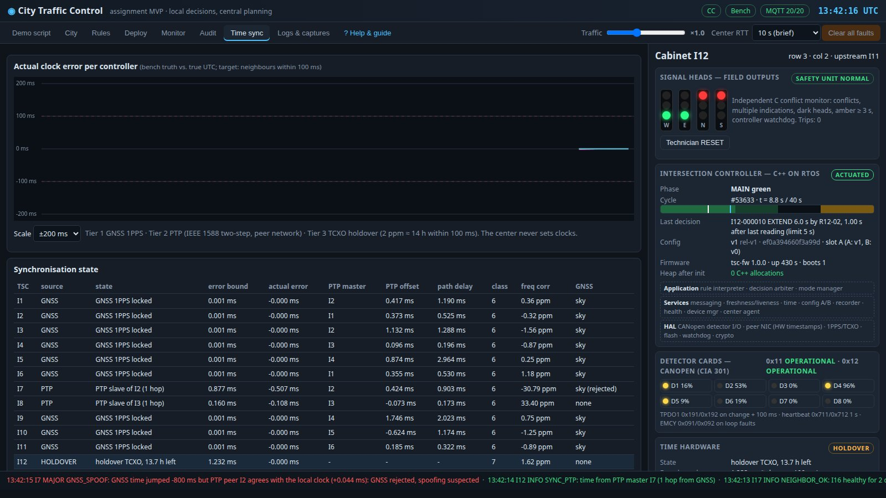

**Where are all alerts?** In four places:
- the ticker at the bottom of the GUI (the latest alarms);
- the **Monitor → Alarms** list (everything the center received, with the delay);
- each controller's log (`[ALARM]` lines);
- MQTT topic `field/tscNN/alarm`.

The `sev` field is `major`, `warn` or `info`.

---

## 10. Where every file is

| Path | Content | Created when |
|---|---|---|
| `controller/src/` | C++ controller: `hal/` hardware layer, `services/` (time, detectors, messages, config store + recorder, MQTT agent), `app/` (phase controller, rule interpreter), `main.cpp` | source |
| `controller/build/tsc`, `controller/build/mmu` | Compiled controller and safety unit | `./demo.sh setup` (CMake) |
| `mmu/mmu.c` | Safety unit source | source |
| `common/city.py`, `common/rules.py`, `common/formats.py` | City model and timing; rule language: parse, validate, compile, evaluate; wire formats | source |
| `control_center/server.py`, `control_center/release.py` | Control center web server; Git, release, signing | source |
| `testbench/` | Street simulation (`plant.py`), network switch and WAN emulator (`net.py`), supervisor and faults (`bench.py`) | source |
| `gui/` | The browser console (plain HTML/CSS/JS) | source |
| `tools/` | Self-test, rule test vectors, `cfg_dump.py`, Wireshark dissector, screenshot script | source |
| `third_party/` | Mosquitto 2.0.18 + libraries (Ubuntu packages), paho-mqtt | `./demo.sh setup` (`scripts/fetch_third_party.sh`) |
| `runtime/rules_repo/INN.rules` | Rule text per intersection (Git repository with history and tags) | setup; on every Save & commit |
| `runtime/cc/releases/vN/` | `tscNN.cfg` signed binaries + `manifest.json` | on every release |
| `runtime/cc/hsm/config_signing.key` | Release signing key (stands in for an HSM) | setup |
| `runtime/cc/records.db` | All uploaded decision records (SQLite) | as records arrive |
| `runtime/pki/` | Certificate authority, server and 21 client certificates, peer-network MAC key, signing public key | setup |
| `runtime/broker/` | Mosquitto configuration, access lists, persistence | setup |
| `runtime/flash/tscNN/` | The controller's "flash": `slot_A.cfg`, `slot_B.cfg`, `active_slot`, `records.jsonl`, `upload_cursor`, `msg_seq` | setup; on deploy; continuously |
| `runtime/logs/` | All logs and captures (section 8.2) | continuously |
| `media/` | Tools that recorded the demo videos (the videos are attached to the GitHub release) | `media/README.md` |
| `docs/` | This guide, `PROTOCOLS.md`, the last self-test report | |

`runtime/` holds keys and live data. It is created by `./demo.sh setup` and is never committed to
Git.

---

## 11. Platform and limitations

**Developed and tested on:** Ubuntu 24.04 LTS, x86-64, 4 CPU cores, 8 GB RAM. Python 3.12,
GCC 13, CMake, OpenSSL 3.

**Runs on Linux only.** It is not expected to run natively on Windows or macOS:
- `demo.sh` is a bash script and uses Linux tools (`nohup`, `pgrep`, `/proc`).
- The controller and safety unit use POSIX APIs: `poll()`, UDP sockets, `signal(SIGPIPE)`,
  `clock_gettime`, `_exit`, and a watchdog thread on pthreads. They do not compile with MSVC.
- Mosquitto, libmosquitto and their libraries come from **Ubuntu 24.04 .deb packages**
  (`scripts/fetch_third_party.sh`, using `apt-get download`; no root needed). On other Linux
  distributions, install the same versions another way.
- The live process panel reads `/proc` (Linux).

**Windows:** use **WSL2 with Ubuntu 24.04** and open the GUI in the Windows browser
(http://127.0.0.1:8080). This should work because WSL2 runs a real Linux kernel, but it has **not been
tested**. A native Windows port would need the socket and timer code behind the existing hardware
layer to be ported, and the bash script replaced. That is not planned for this prototype.

**Resources:** 43 processes. Keep the machine otherwise quiet: the safety units correctly trip to
flashing if a controller misses its 1-second watchdog. A host that freezes for over a second (heavy
swapping, video encoding) therefore puts intersections into flash. That is the intended safe
behaviour, not a bug.

**Real vs simulated.**
- Real: the controller, safety-unit and control-center software; MQTT over TLS with certificates;
  Ed25519, AES-CMAC and SHA-256; IEEE 1588 message formats; CANopen frame formats; NMEA sentences;
  Git.
- Simulated by the testbench: the street and vehicles, the detector cards, the CAN wiring
  (`can_frame` over UDP, because a virtual CAN interface needs root), the network switch, the GNSS
  receiver and the crystal.
- Substitutes: the RTOS is replaced by a 10 ms loop on Linux, and the HSM by a key file.
- PTP uses software timestamps, so it is accurate to ~0.1–1 ms, not sub-microsecond. That is still
  far inside the 100 ms target.
- No conformance to traffic-signal standards (EN 12675, NEMA TS 2, NTCIP, …) is claimed. The safety
  thresholds are demo values.

---

## 12. Glossary

| Term | Meaning |
|---|---|
| **Actuated** | Signal timing that reacts to detectors (here: the main-green extension and skipping the side street) |
| **All-red** | A short time when every head is red, so the box clears before cross traffic starts |
| **Arbiter** | The step that picks one action from all rules: highest priority with an action wins |
| **CANopen / EMCY / heartbeat / TPDO** | Industrial field bus between controller and detector cards. *Heartbeat* = "I am alive" every second; *TPDO* = the presence data; *EMCY* = emergency message for a broken loop |
| **Cycle / split / offset** | Cycle = the repeating 40 s pattern; split = how it is divided between main and side; offset = when the cycle starts relative to the city clock (8 s per column) |
| **DEGRADED / FIXED_TIME / FLASH** | Some inputs missing, rules use fallbacks / no usable local detection, fixed plan / safety unit took over, flashing |
| **Green wave / platoon** | Lights timed so a group of cars (a platoon) driving together meets green after green |
| **Gridlock** | Cars stuck in an intersection because the road ahead is full, blocking cross traffic |
| **Holdover** | Keeping time on the local crystal after losing GNSS and PTP |
| **Last will (LWT)** | A message the broker publishes for a client when its connection dies (`offline`) |
| **MMU / safety unit / conflict monitor** | Independent device that watches the lamps and forces flashing on any unsafe state |
| **mTLS** | Mutual TLS: both sides prove their identity with certificates |
| **PTP (IEEE 1588)** | Precision Time Protocol: computers synchronise clocks over Ethernet |
| **QoS 1** | MQTT "at least once": the message is repeated until acknowledged, and queued while the receiver is away |
| **Upstream** | The intersection your traffic comes from (west; for I8, I13, I18 also north) |
